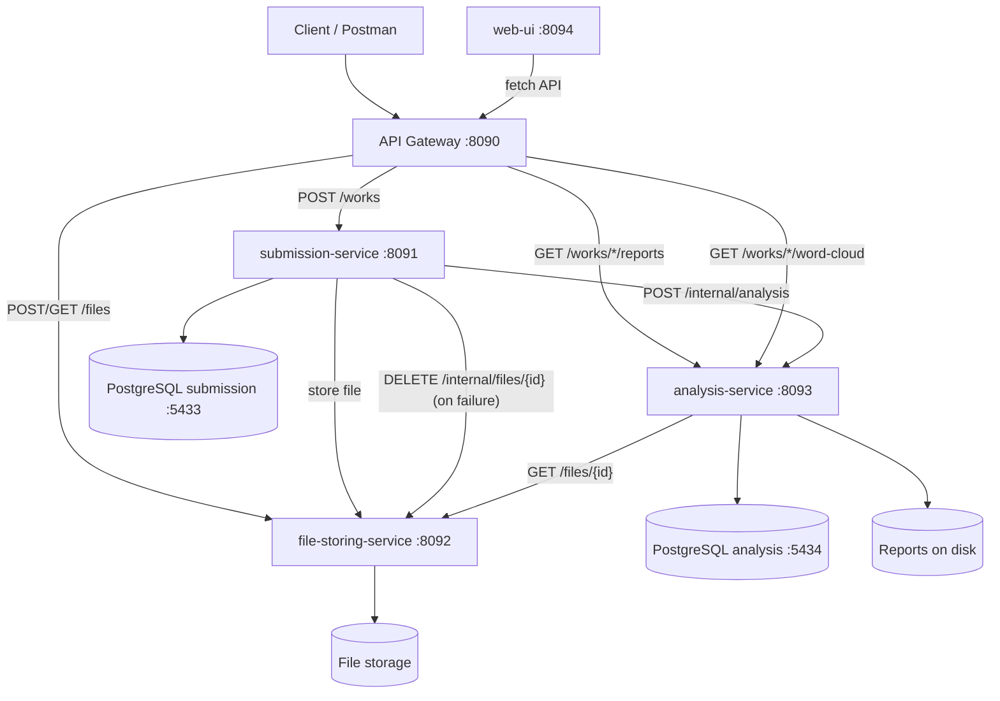
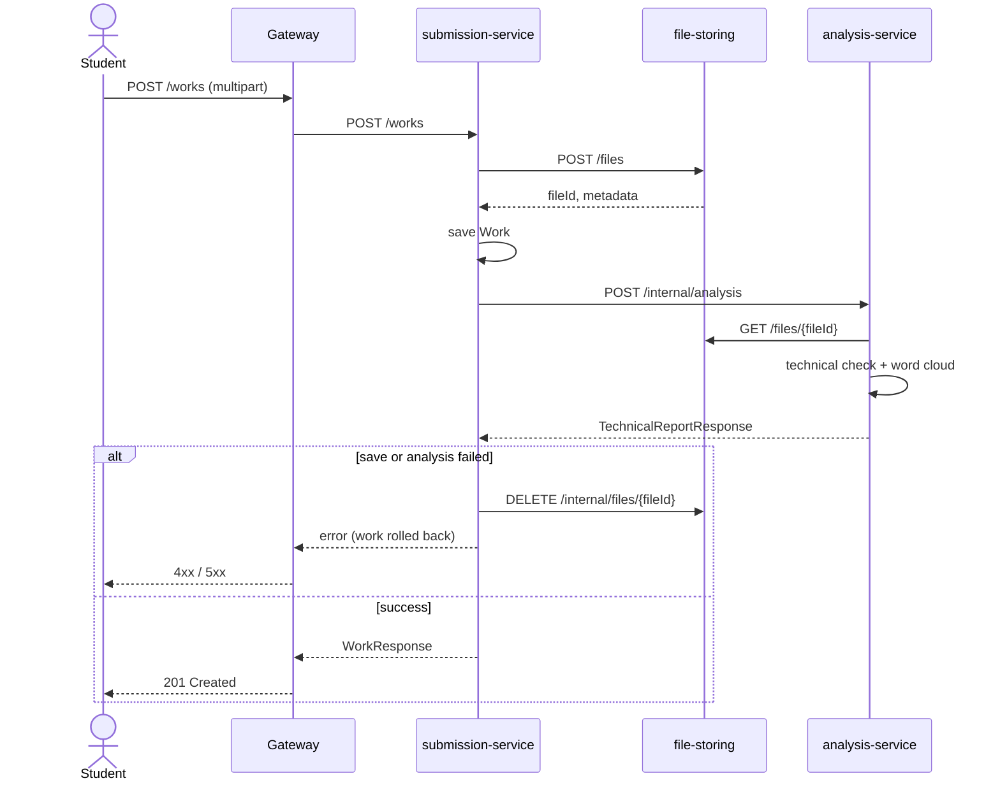
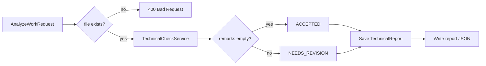
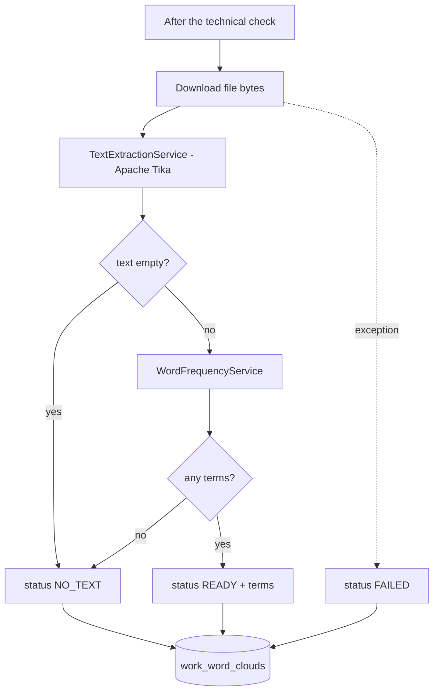
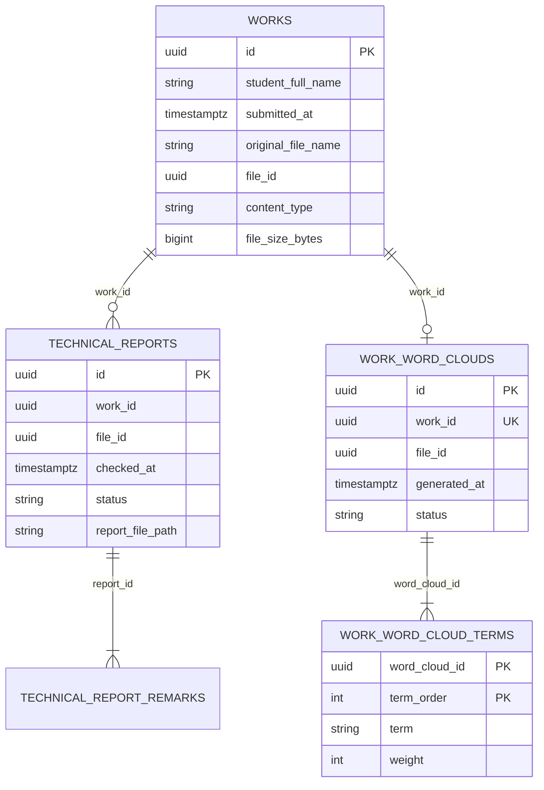

# CosmoScan

A system for receiving and pre-processing student works: file upload, technical check, report
generation and word cloud data for visualization.

---

## Contents

- [Architecture](#architecture)
- [What the system does](#what-the-system-does)
- [User scenarios](#user-scenarios)
- [Service interaction scenarios](#service-interaction-scenarios)
- [Data models](#data-models)
- [Public API (through the gateway)](#public-api-through-the-gateway)
- [Build and dependencies](#build-and-dependencies)
- [Running and checking](#running-and-checking)
- [Web portal (web-ui)](#web-portal-web-ui)
- [Testing](#testing)
- [Known limitations](#known-limitations)
- [Dependencies and licenses](#dependencies-and-licenses)
- [Repository structure](#repository-structure)

---

## Architecture



| Service | Port | Purpose |
|---------|------|---------|
| **web-ui** | 8094 | Static portal (nginx): scenarios UC-1 to UC-3, links to Swagger, health and JaCoCo |
| **gateway** | 8090 | Single API entry point, routing |
| **submission-service** | 8091 | Receives works, stores work metadata in its database |
| **file-storing-service** | 8092 | Stores files on disk |
| **analysis-service** | 8093 | Technical check, reports, word cloud |
| **submission-db** | 5433 | Works database |
| **analysis-db** | 5434 | Reports and word cloud database |

The internal endpoints `POST /internal/analysis` (analysis-service) and
`DELETE /internal/files/{fileId}` (file-storing-service) are **not** routed by the gateway; only
submission-service calls them.

---

## What the system does

### 1. Microservice decomposition

The project consists of four runnable Gradle modules and two supporting ones:

- **gateway** - Spring Cloud Gateway: routes to the services, Swagger UI under `/swagger/{service}/`,
  Actuator health endpoint.
- **submission-service** - REST API for submitting works (`multipart/form-data`), JPA + Flyway,
  PostgreSQL.
- **file-storing-service** - file upload, download and internal delete; format and size
  validation; files are stored in a directory on disk.
- **analysis-service** - technical check, reports in the database and as JSON on disk, word cloud
  data.
- **file-validation** - plain Java library with the file rules (allowed formats, size limit, ZIP
  ban) shared by the three services. Before it existed, the same validator was copied into
  submission-service and file-storing-service.
- **e2e-tests** - end-to-end API tests that run against a running stack (see [Testing](#testing)).

Every runnable module has its own `Dockerfile` and a service in `docker-compose.yml`. All
application containers have a Compose health check: the Spring services and the gateway use
`/actuator/health`, web-ui is checked with an HTTP request to nginx. Containers start in
`depends_on` order and wait for their dependencies to become `healthy`.

### 2. End-to-end "Submit work" flow

`POST /works` runs this chain:

1. File validation (extension `pdf` / `docx` / `txt`, at most **1 MiB**, no ZIP).
2. The file is stored in **file-storing-service**, which returns a `fileId`.
3. Work metadata is written to **submission-db** (`workId`, student name, `fileId`, file name, size,
   content type).
4. Synchronous call to **analysis-service** (`POST /internal/analysis`).
5. The client receives a `WorkResponse` with a short technical report.

If step 3 or 4 fails, the work row is rolled back by the transaction and submission-service deletes
the already stored file (`DELETE /internal/files/{fileId}`), so no orphan file is left behind. The
original error is returned to the client.

### 3. Technical analysis (analysis-service)

- Checks that the file exists in file-storing (`GET /files/{fileId}`).
- **TechnicalCheckService** checks the metadata (size, extension, content type) against the shared
  file rules, without reading the content.
- Report statuses: `ACCEPTED` / `NEEDS_REVISION`, plus a list of `remarks`.
- The report is saved in PostgreSQL and also written as a JSON file (`ReportFileWriter`).

### 4. Word cloud

Built in **analysis-service** during the same analyze call:

- The file is downloaded from file-storing.
- Text is extracted with **Apache Tika 2.9.2** (Apache-2.0 license).
- Word frequencies are counted by the project's own **WordFrequencyService** (English and Russian
  stop words, minimum word length 3).
- Results are stored in the `work_word_clouds` / `work_word_cloud_terms` tables.
- Statuses: `READY`, `NO_TEXT`, `FAILED` (an extraction error does not cancel the submission).

Public read: `GET /works/{workId}/word-cloud` returns JSON with a `{ "text", "weight" }` array for
client-side rendering (for example with wordcloud2.js).

### 5. API Gateway

Routes public requests on port **8090**:

- `POST /works` -> submission-service
- `GET /works/{workId}/reports` -> analysis-service
- `GET /works/{workId}/word-cloud` -> analysis-service
- `POST /files`, `GET /files/{fileId}` -> file-storing-service
- `GET /actuator/health` - the gateway's own health

### 6. Quality and API documentation

- **OpenAPI (springdoc)** on every service.
- **Unit tests** with a JaCoCo gate of **100%** instructions, lines and branches for gateway,
  submission-service, file-storing-service, analysis-service and file-validation (`check` task).
- **End-to-end API tests** in `e2e-tests/` (JUnit 5 + REST Assured) against the gateway.
- **Postman** test scripts in `postman/`, described in [postman/README.md](postman/README.md).
- **web-ui** - single-page portal (HTML/CSS/JS + nginx in Docker); the word cloud is drawn in the
  browser with **wordcloud2.js**, the terms are computed by **analysis-service** in Java.

---

## User scenarios

### UC-1. A student submits a work

**Actor:** student (or an external system)
**Goal:** upload a work and immediately get the technical check result.

| Step | Action |
|------|--------|
| 1 | The client sends `POST /works` to the gateway (`studentFullName` + file). |
| 2 | The system validates and stores the file. |
| 3 | The system runs the analysis. |
| 4 | The client receives `201` with the work `id`, `fileId` and a `technicalReport` block (`status`, `remarks`). |

**Result:** the work is registered; with `NEEDS_REVISION` the `remarks` list the reasons (size,
format and so on).



---

### UC-2. A teacher views the report history

**Actor:** teacher
**Goal:** get all technical reports of a `workId`.

| Step | Action |
|------|--------|
| 1 | `GET /works/{workId}/reports` through the gateway. |
| 2 | Response: an array of reports sorted by date (newest first). |

*Note:* a regular UC-1 submission creates one report; the array exists for repeated
`POST /internal/analysis` calls (internal scenario).

---

### UC-3. Work content visualization (word cloud)

**Actor:** teacher / analyst
**Goal:** see the word frequencies of the work text.

| Step | Action |
|------|--------|
| 1 | After submitting the work (UC-1), call `GET /works/{workId}/word-cloud`. |
| 2 | With `status: READY` use the `terms` array for the cloud in the UI. |
| 3 | With `NO_TEXT` / `FAILED` show a message to the user. |

---

### UC-4. Direct file upload (without a work)

**Actor:** integrator / tester
**Goal:** store a file and get a `fileId`.

| Step | Action |
|------|--------|
| 1 | `POST /files` with a multipart `file`. |
| 2 | `GET /files/{fileId}` - download through the gateway. |

*Note:* the regular flow is the UC-1 submission; UC-4 is useful for debugging file-storing.

---

## Service interaction scenarios

### TS-1. Synchronous orchestration on submit

| # | From | To | Method | Data |
|---|---|---|--------|--------|
| 1 | submission | file-storing | `POST /files` | `MultipartFile` |
| 2 | submission | analysis | `POST /internal/analysis` | JSON `AnalyzeWorkRequest` |
| 3 | analysis | file-storing | `GET /files/{fileId}` | existence check + download for the word cloud |
| 4 | submission | file-storing | `DELETE /internal/files/{fileId}` | only if step 2 or saving the work failed |

**AnalyzeWorkRequest** (body of the internal call):

```json
{
  "workId": "uuid",
  "fileId": "uuid",
  "studentFullName": "string",
  "originalFileName": "work.pdf",
  "contentType": "application/pdf",
  "fileSizeBytes": 12345
}
```

**Failure handling:** if the file is missing in file-storing, analysis returns `400` and submission
passes the `400` to the client. Whenever saving the work or the analysis call fails, the JPA
transaction in submission rolls back the `works` row and submission deletes the stored file
(compensating action). If that delete also fails, the error is logged and attached to the original
exception as suppressed; the file then stays in storage (see
[Known limitations](#known-limitations)).

---

### TS-2. Technical check (without parsing the text)



The rules come from the shared **file-validation** module and are the same as on upload:
**pdf, docx, txt**, at most 1 MiB, no ZIP.

---

### TS-3. Building the word cloud



---

### TS-4. Reads through the gateway (without submission)

| Client request | Target service | Note |
|----------------|-------------------|------------|
| `GET /works/{id}/reports` | analysis-service | Read-only from analysis-db |
| `GET /works/{id}/word-cloud` | analysis-service | 404 if the analysis has not run yet |
| `GET /files/{id}` | file-storing-service | Binary file body |

submission-service is **not** involved in these scenarios.

---

### TS-5. Data storage per service

The **logical** model below spans two separate databases: `works` in submission-db, reports and
word cloud in analysis-db. There are no foreign keys between the PostgreSQL instances.



**Outside the databases:**

| Service | Artifact | Path (default) |
|--------|----------|---------------------|
| file-storing | work files + `metadata.json` per file | `STORAGE_FILES_PATH` / Docker volume |
| analysis | report JSON files | `STORAGE_REPORTS_PATH` |

The databases are linked only logically through shared `workId` and `fileId` (UUID).

---

## Data models

### WorkResponse (submit response)

| Field | Type | Description |
|------|-----|----------|
| `id` | UUID | Work id |
| `studentFullName` | string | Student full name (trimmed) |
| `submittedAt` | ISO-8601 | Submission time |
| `originalFileName` | string | File name |
| `fileId` | UUID | Reference to file-storing |
| `fileSizeBytes` | number | Size |
| `contentType` | string | MIME type |
| `technicalReport` | object | `id`, `status`, `remarks`, `checkedAt` |

### WordCloudResponse

| Field | Type | Description |
|------|-----|----------|
| `workId` | UUID | Work |
| `fileId` | UUID | Source file |
| `generatedAt` | ISO-8601 | Calculation time |
| `status` | enum | `READY` \| `NO_TEXT` \| `FAILED` |
| `terms` | array | `{ "text": "...", "weight": N }` |

Errors are returned as RFC 7807 `ProblemDetail` JSON with a `detail` field.

---

## Public API (through the gateway)

Base URL: `http://localhost:8090`

| Method | Path | Codes | Description |
|-------|------|------|----------|
| `POST` | `/works` | `201`, `400`, `413` | Submit a work (`studentFullName`, `file`). `400` for a disallowed file or blank name; a file over the 1 MiB upload limit can get `413` |
| `GET` | `/works/{workId}/reports` | `200`, `400` | List of technical reports (may be empty); `400` for a malformed UUID |
| `GET` | `/works/{workId}/word-cloud` | `200`, `404` | Word cloud data (`404` - the analysis has not run) |
| `POST` | `/files` | `201`, `400` | Upload a file |
| `GET` | `/files/{fileId}` | `200`, `404` | Download a file |
| `GET` | `/actuator/health` | `200` | Gateway health |

**Internal endpoints (not routed by the gateway):**

| Service | Method | Path | Called by |
|---------|--------|------|-----------|
| analysis-service | `POST` | `/internal/analysis` | submission-service |
| file-storing-service | `DELETE` | `/internal/files/{fileId}` | submission-service (compensation) |

**Swagger UI (through the gateway, springdoc 2.x):**

- `http://localhost:8090/swagger/submission/swagger-ui/index.html`
- `http://localhost:8090/swagger/files/swagger-ui/index.html`
- `http://localhost:8090/swagger/analysis/swagger-ui/index.html`

---

## Build and dependencies

The project is built in two ways: **Docker Compose** (recommended for running the whole system) and
**Gradle on the host** (tests, JaCoCo, local development without containers).

### Docker Compose (`docker compose up --build`)

The command **builds** the images and **starts** all containers. On the first run Docker also
**pulls** the base images.

| Step | What happens |
|-----|----------------|
| 1 | Pulls `postgres:16-alpine`, `eclipse-temurin:17`, `nginx:1.27-alpine` (if not present locally) |
| 2 | **gateway**, **submission-service**, **file-storing-service**, **analysis-service** - multi-stage build: `./gradlew :<module>:bootJar -x test` runs inside the container |
| 3 | Gradle downloads the **Java dependencies** from **Maven Central** (Spring Boot, Spring Cloud Gateway, PostgreSQL driver, Flyway, Apache Tika, springdoc and transitive JARs) into the Docker layer cache |
| 4 | The runtime image contains only **JRE + the JAR**; sources are not copied into the final image |
| 5 | **web-ui** - multi-stage: the JDK stage runs `./gradlew check copyJacocoReportsForWeb` (unit tests, 100% JaCoCo gate, HTML into `web-ui/reports/`); the nginx stage gets `index.html`, `assets/` and the reports |
| 6 | Containers start in `depends_on` order; every container waits for its dependencies to be `healthy` |

The **web-ui** build takes longer than the others because it runs the tests. The service JARs are
built with `-x test` so the tests do not run several times.

Services and ports are listed in [Architecture](#architecture) and `docker-compose.yml`.

### Web portal dependencies (web-ui)

| Component | When it is fetched | From |
|-----------|---------------------|--------|
| Portal HTML, CSS, JS (`app.js`) | `web-ui` image build | Repository files -> nginx |
| PNG diagrams | `web-ui` image build | `web-ui/assets/images/` |
| JaCoCo HTML (`/reports/submission`, `files`, `analysis`, `gateway`, `file-validation`) | `web-ui` image build (Gradle `check` + `copyJacocoReportsForWeb`) | Generated inside Docker, nothing to do on the host |
| **wordcloud2.js** | **When the page is opened in the browser** | CDN [jsDelivr](https://cdn.jsdelivr.net/npm/wordcloud@1.2.2/src/wordcloud2.min.js) (MIT) |

The cloud is drawn in the browser; the **terms are computed** in **analysis-service** (Java). Work
data is not sent to the CDN.

To use the portal **without internet access**, put `wordcloud2.min.js` into
`web-ui/assets/vendor/` and change the `<script src="...">` in `index.html`.

The PNG diagrams are rendered from `web-ui/diagrams/plantuml/*.puml`. After changing a diagram:

```bash
./gradlew renderDiagrams
```

### Build on the host (Gradle)

```bash
# Windows
gradlew.bat build

# Linux/macOS
./gradlew build
```

Downloads the same Maven dependencies into the local `~/.gradle` cache. The `check` task runs the
unit tests and the JaCoCo gate (100%). `copyJacocoReportsForWeb` copies the HTML reports into
`web-ui/reports/` for the JaCoCo section of the portal. The end-to-end tests are compiled but not
run by `build`.

To run the JARs without Docker you need local PostgreSQL and the variables from `application.yml`
(see [local development](#local-development-without-docker)).

---

## Running and checking

### Requirements

- **Docker Compose** - for the full stack (a JDK on the host is not required)
- **JDK 17+** and **Gradle (gradlew)** - for tests and builds without Docker

### Docker Compose

From the repository root:

```bash
# Build the images and start all services (logs in the console)
docker compose up --build

# Same, in the background
docker compose up --build -d

# Stop
docker compose down

# Stop and remove database and file volumes
docker compose down -v
```

**Windows (PowerShell):** the same commands; for builds without Docker use `gradlew.bat` instead of
`./gradlew`.

Wait until all containers are `healthy` (`docker compose ps`): both databases, the three services,
the gateway and web-ui.

| URL | Purpose |
|-----|------------|
| http://localhost:8094 | Web portal |
| http://localhost:8090 | API Gateway (portal and Swagger requests) |

Health checks:

```bash
curl http://localhost:8090/actuator/health
curl http://localhost:8091/actuator/health
curl http://localhost:8092/actuator/health
curl http://localhost:8093/actuator/health
```

Check through the gateway (after all containers are up, Swagger UI HTML is expected):

```bash
curl http://localhost:8090/swagger/submission/swagger-ui/index.html
```

### Local development (without Docker)

1. Start PostgreSQL (defaults from `application.yml`):

| Instance | Port | Database | User / Password |
|---------|------|----------|-----------------|
| submission | 5433 | `cosmoscan_submission` | `cosmoscan` / `cosmoscan` |
| analysis | 5434 | `cosmoscan_analysis` | `cosmoscan` / `cosmoscan` |

2. Start the services in this order: file-storing -> analysis -> submission -> gateway.
3. Environment variables are listed in `application.yml` of each module.

### Example: submit a work

```bash
curl -X POST http://localhost:8090/works \
  -F "studentFullName=Ivan Ivanov" \
  -F "file=@test.txt"
```

```bash
# use the UUID from the "id" field of the POST /works response
curl http://localhost:8090/works/00000000-0000-0000-0000-000000000001/word-cloud
```

---

## Web portal (web-ui)

The `web-ui/` folder is a static portal on **nginx** (container `web-ui`, port **8094**).

| Portal section | Description |
|----------------|----------|
| API connection | Gateway base URL (default `http://localhost:8090`) |
| Swagger / Health | Links to Swagger UI and to the Actuator health of the gateway and services |
| UC-1 | Submit a work (`POST /works`) |
| UC-2 | Technical reports by UUID |
| UC-3 | "Get word cloud" button + canvas |
| JaCoCo | Links to the HTML coverage reports |
| Architecture | System and UC-1 diagrams (`assets/images/`) |

Portal API requests go to the gateway (`localhost:8090`). The only external JS is **wordcloud2**
from a CDN (see [Build and dependencies](#build-and-dependencies)).

JaCoCo reports after `docker compose up --build`:
http://localhost:8094/reports/submission/index.html (and `files`, `analysis`, `gateway`,
`file-validation`).

---

## Testing

| Level | Where | Runs in `build` | Needs the stack |
|-------|-------|-----------------|-----------------|
| Unit tests | `*/src/test` | yes | no |
| End-to-end API tests | `e2e-tests/` | no (compiled only) | yes |
| Postman checks | `postman/` | no | yes |

### Unit tests and coverage

Unit tests use JUnit 5, Mockito, AssertJ, standalone MockMvc (controllers), `MockRestServiceServer`
(HTTP clients) and one `@WebMvcTest` for request validation. They need no database or network.

JaCoCo is a hard gate: `check` fails unless **instructions, lines and branches are 100% covered** in
gateway, submission-service, file-storing-service, analysis-service and file-validation. There are
no exclusions.

```bash
# All unit tests + JaCoCo gate (Linux/macOS)
./gradlew check

# Windows
gradlew.bat check

# One module
./gradlew :analysis-service:test

# Copy the JaCoCo HTML reports into web-ui/reports/ (already part of the web-ui Docker build)
./gradlew copyJacocoReportsForWeb
```

HTML reports: `<module>/build/reports/jacoco/test/html/index.html`.

### End-to-end API tests

`e2e-tests/` holds black-box tests (JUnit 5 + REST Assured) that call the API through the gateway,
exactly like a client:

| Test class | What it checks |
|------------|----------------|
| `SubmitWorkE2eTest` | UC-1 to UC-3 for `.txt`, `.docx` and `.pdf`: submit, report history, word cloud with the expected top word, download of the stored file |
| `SubmitWorkValidationE2eTest` | Rejected files (format, missing extension, ZIP, empty, over 1 MiB), the 1 MiB boundary, missing or blank student name, missing file |
| `ReadApiE2eTest` | Reads for unknown works, malformed UUID, `NO_TEXT` word cloud |
| `FileStorageE2eTest` | UC-4: upload/download round trip, validation on direct upload, unknown file |
| `GatewayE2eTest` | Gateway health, Swagger routing, internal endpoints not exposed, unknown route |

Fixtures with one dominant word each are in `e2e-tests/src/test/resources/files/`.

The tests are not part of `build`/`check` (the regular `test` task of the module is disabled). Run
them against a running stack:

```bash
docker compose up --build -d
./gradlew :e2e-tests:e2eTest

# another gateway address
./gradlew :e2e-tests:e2eTest -Pcosmoscan.baseUrl=http://my-host:8090
```

The gateway address can also be set with the `COSMOSCAN_BASE_URL` environment variable. The tests
are not wired into CI yet.

### Postman

Manual checks with Postman test scripts: see [postman/README.md](postman/README.md).

---

## Known limitations

- **No authentication or authorization.** Every public endpoint is open; internal endpoints are
  protected only by not being routed through the gateway. The services' own ports (8091-8093) are
  published by Compose for debugging, so internal endpoints are reachable on those ports.
- **Compensation is best effort.** If deleting the stored file after a failed submit also fails, the
  file stays in storage (the error is logged). Data written by analysis-service before a later
  failure in submission (report, word cloud) is not rolled back.
- **Synchronous processing.** Text extraction and the word cloud run inside the `POST /works`
  request, so large documents make the request slower.
- **End-to-end tests are not run automatically** - there is no CI pipeline yet.

---

## Dependencies and licenses

Only **permissive** licenses (Apache-2.0, MIT, BSD-style) are used in runtime dependencies. There is
no copyleft (application-wide GPL) in direct runtime dependencies.

### Backend (Gradle / Maven Central)

| Dependency | Modules | License | Purpose |
|-------------|--------|----------|------------|
| Spring Boot 3.3.x | all services | **Apache-2.0** | REST, JPA, Validation, Actuator |
| Spring Cloud Gateway 2023.0.x | gateway | **Apache-2.0** | API Gateway |
| springdoc-openapi 2.6.x | submission, file-storing, analysis | **Apache-2.0** | Swagger UI / OpenAPI |
| Flyway | submission, analysis | **Apache-2.0** | Database migrations |
| PostgreSQL JDBC Driver | submission, analysis | **BSD-2-Clause** (PostgreSQL License) | Database driver |
| **Apache Tika 2.9.2** (`tika-core`, `tika-parsers-standard-package`) | analysis | **Apache-2.0** | Text extraction from pdf/docx/txt |
| reactive-streams | submission | **MIT** | Transitive dependency |
| JUnit 5, Mockito, AssertJ, Spring Boot Test | tests | **EPL-2.0** / **MIT** / **Apache-2.0** | Tests only, not in the production JARs |
| REST Assured | e2e-tests | **Apache-2.0** | End-to-end API tests only |
| JaCoCo | tests / `check` | **EPL-2.0** | Coverage reports |
| PlantUML (`plantuml-mit`) | build-time `renderDiagrams` | **MIT** | Renders the portal diagrams; not shipped |

**Own code (no third-party NLP libraries):** `WordFrequencyService`, `TechnicalCheckService`, stop
words and tokenization for the word cloud.

**Tika:** `tika-parsers-standard-package` brings transitive parser JARs (PDF and others); for strict
compliance in an organization, produce the full tree with
`./gradlew :analysis-service:dependencies`.

### Web portal (`web-ui/`)

| Component | Version | License | Purpose |
|-----------|--------|----------|------------|
| **wordcloud2.js** (npm `wordcloud`) | 1.2.2 | **MIT** | Draws the cloud on a `<canvas>` from the API JSON |
| nginx (Docker image) | 1.27-alpine | **BSD-2-Clause** | Serves the static files |

wordcloud2 is loaded in `index.html` from the jsDelivr CDN (`wordcloud@1.2.2`, MIT). Diagram
sources: `web-ui/diagrams/plantuml/`, PNGs in `web-ui/assets/images/`.

Own portal files: `index.html`, `assets/css/style.css`, `assets/js/app.js`.

### Docker images (Compose)

| Image | License (typical) |
|-------|---------------------|
| `eclipse-temurin:17` | **GPLv2 + Classpath Exception** (JRE) |
| `postgres:16-alpine` | **PostgreSQL License** |
| `nginx:1.27-alpine` | **BSD-2-Clause** |

---

## Repository structure

```
CosmoScan/
├── gateway/
├── submission-service/
├── file-storing-service/
├── analysis-service/
├── file-validation/          shared file rules (library)
├── e2e-tests/                end-to-end API tests
├── web-ui/
│   ├── index.html
│   ├── assets/
│   ├── diagrams/plantuml/
│   ├── nginx.conf
│   ├── Dockerfile
│   └── reports/
├── postman/
│   ├── README.md
│   ├── cosmoscan-api-tests.js
│   └── files/
├── docker-compose.yml
├── build.gradle
└── settings.gradle
```
