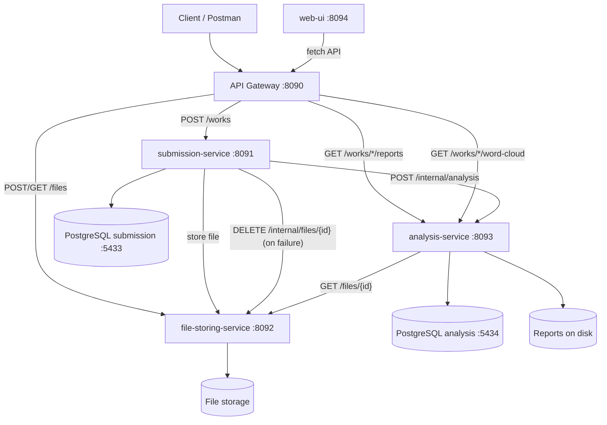
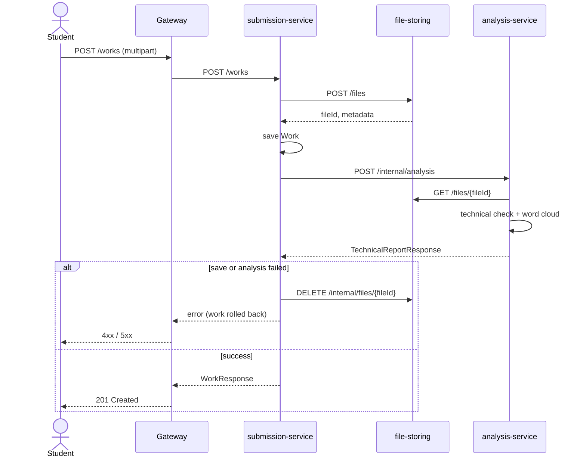
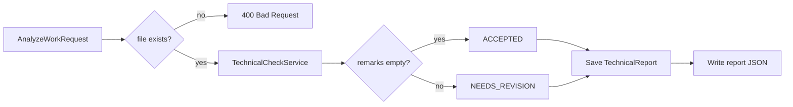
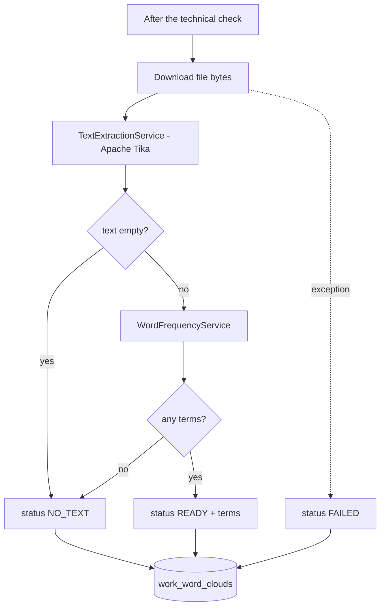
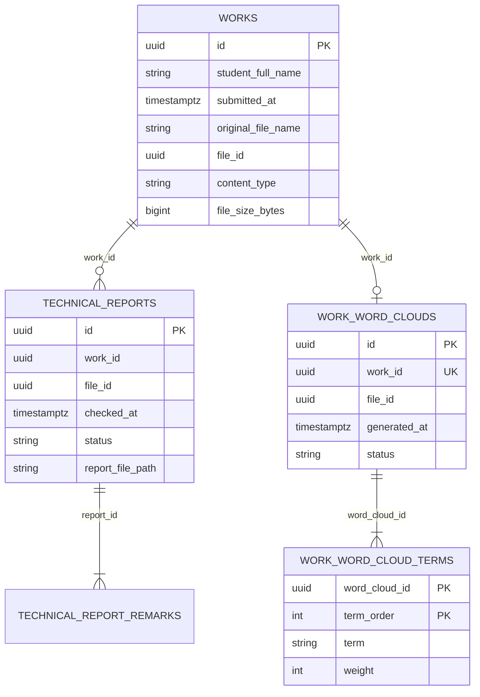
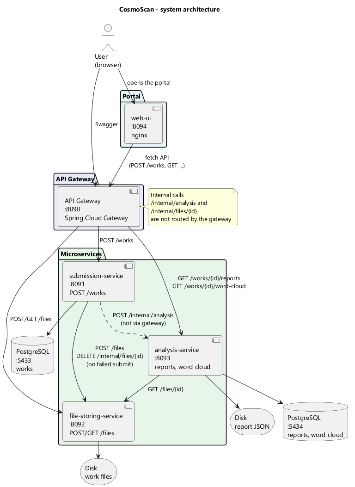
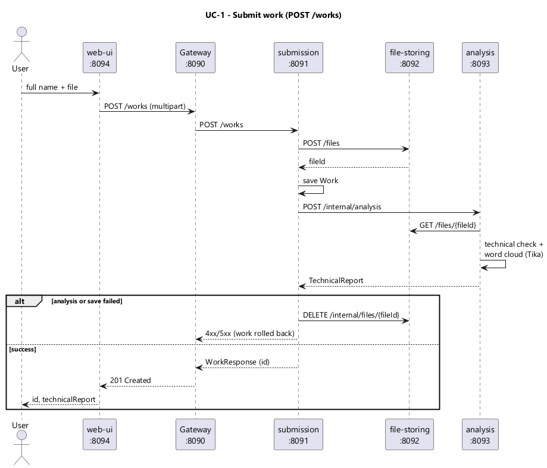

# Diagrams

[Back to README](../README.md) | [All diagrams](diagrams.md)

All diagrams of CosmoScan in one place. Mermaid diagrams are rendered by GitHub directly; the
PlantUML diagrams are the ones shown on the web portal.

- [System architecture](#system-architecture)
- [UC-1: submit a work](#uc-1-submit-a-work)
- [TS-2: technical check](#ts-2-technical-check)
- [TS-3: building the word cloud](#ts-3-building-the-word-cloud)
- [TS-5: data model](#ts-5-data-model)
- [Portal diagrams (PlantUML)](#portal-diagrams-plantuml)

## System architecture

Services and ports: [README](../README.md#services). Description: [architecture.md](architecture.md).

## UC-1: submit a work

Scenario: [user-scenarios.md](user-scenarios.md#uc-1-a-student-submits-a-work).

## TS-2: technical check

Description: [architecture.md](architecture.md#ts-2-technical-check-without-parsing-the-text).

## TS-3: building the word cloud

Description: [architecture.md](architecture.md#ts-3-building-the-word-cloud).

## TS-5: data model

Logical model over two separate databases (no foreign keys between the PostgreSQL instances).

Description: [architecture.md](architecture.md#ts-5-data-storage-per-service).

## Portal diagrams (PlantUML)

These PNGs are shown on the web portal. Sources are in
[`web-ui/diagrams/plantuml/`](../web-ui/diagrams/plantuml/); after changing a source, regenerate the
images with `./gradlew renderDiagrams`.

### Architecture

### UC-1 sequence

