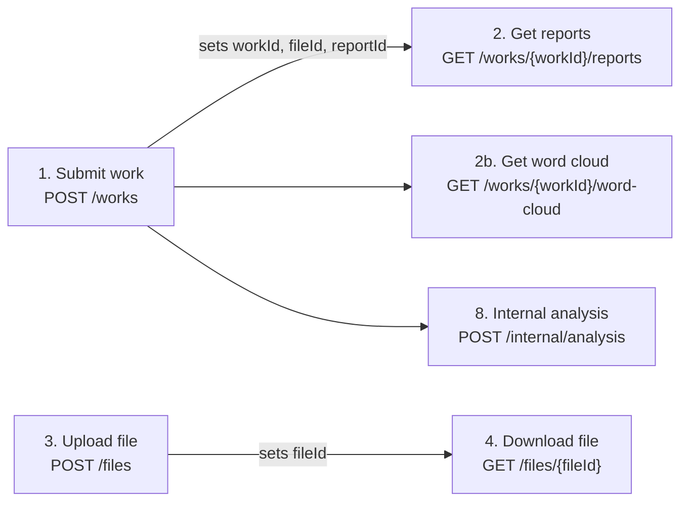

# Postman checks

Manual API checks for CosmoScan in Postman. They complement the automated tests:

| Kind | Where | How it runs |
|---|---|---|
| Unit tests | `*/src/test` | `./gradlew check` (100% coverage gate) |
| End-to-end API tests | `e2e-tests/` | `./gradlew :e2e-tests:e2eTest` against a running stack |
| Postman checks | `postman/` (this folder) | By hand or with the Postman Collection Runner |

The repository does **not** contain a Postman collection export. It contains:

| File | Purpose |
|---|---|
| `cosmoscan-api-tests.js` | Test scripts. Each block is pasted into the **Tests** tab of one request |
| `files/cyrillic-and-latin.txt` | Text with Cyrillic and Latin words, to see a mixed-language word cloud |
| `files/archive.zip` | ZIP archive for the negative "invalid file" request |

More valid sample files (`.txt`, `.docx`, `.pdf`) are in `e2e-tests/src/test/resources/files/`.

## How the scripts work

Postman runs the script in the **Tests** tab after the response arrives. The scripts use the
Postman `pm` API:

- `pm.test(name, fn)` - one named check; it fails if an assertion inside it fails.
- `pm.response` - status, headers and body of the response (`pm.response.json()`).
- `pm.expect(...)` - Chai assertions.
- `pm.collectionVariables.set/get` - pass ids between requests.

The requests are chained through collection variables:



So "Submit work" must run before the requests that use `{{workId}}`, and "Upload file" before
"Download file".

## Setup

1. Start the stack from the repository root and wait until all containers are `healthy`:

   ```bash
   docker compose up --build -d
   docker compose ps
   ```

2. In Postman create a collection named **CosmoScan**.
3. Add collection variables (Initial and Current value):

   | Variable | Value |
   |---|---|
   | `gatewayUrl` | `http://localhost:8090` |
   | `submissionUrl` | `http://localhost:8091` |
   | `fileStoringUrl` | `http://localhost:8092` |
   | `analysisUrl` | `http://localhost:8093` |
   | `workId` | empty, set by "Submit work" |
   | `fileId` | empty, set by "Upload file" / "Submit work" |
   | `reportId` | empty, optional |

4. Create folders and requests as listed below. For each request, paste the matching block from
   `cosmoscan-api-tests.js` into the **Tests** tab. Blocks start with a `// --- Name ---` comment;
   the comment above each block lists method, URL and body.

## Requests

| # | Folder | Request | Tests block |
|---|---|---|---|
| 1 | API Gateway | `POST {{gatewayUrl}}/works` (form-data: `studentFullName`, `file`) | Submit work (Gateway) |
| 2 | API Gateway | `GET {{gatewayUrl}}/works/{{workId}}/reports` | Get reports (Gateway) |
| 2b | API Gateway | `GET {{gatewayUrl}}/works/{{workId}}/word-cloud` | Get word cloud (Gateway) |
| 3 | API Gateway | `POST {{gatewayUrl}}/files` (form-data: `file`) | Upload file (Gateway) |
| 4 | API Gateway | `GET {{gatewayUrl}}/files/{{fileId}}` | Download file (Gateway) |
| 5 | Submission Service (8091) | `POST {{submissionUrl}}/works` | Submit work (Gateway) |
| 6 | File Storing Service (8092) | `POST {{fileStoringUrl}}/files` | Upload file (Gateway) |
| 7 | File Storing Service (8092) | `GET {{fileStoringUrl}}/files/{{fileId}}` | Download file (Gateway) |
| 7b | File Storing Service (8092) | `DELETE {{fileStoringUrl}}/internal/files/{{fileId}}` | Delete file (internal) |
| 8 | Analysis Service (8093) | `POST {{analysisUrl}}/internal/analysis` (JSON body) | Internal analysis |
| 9 | Analysis Service (8093) | `GET {{analysisUrl}}/works/{{workId}}/reports` | Get reports (Gateway) |
| 10 | Negative scenarios | `POST {{gatewayUrl}}/works` with `files/archive.zip` | Invalid file upload |
| 11 | Negative scenarios | `GET {{gatewayUrl}}/files/00000000-0000-0000-0000-000000000000` | File not found |

Requests 5-9 call the services directly, bypassing the gateway. `POST /internal/analysis` and
`DELETE /internal/files/{fileId}` exist only on the services; through the gateway they return 404.

Run request 7b last for a given `fileId`: it deletes the file, so downloads of it return 404 afterwards.

## Running the whole collection

Open the collection, click **Run**, keep the folder order (top to bottom) and start the run.
The Runner shows each `pm.test` as passed or failed.

For a run without the Postman app the collection can be exported to JSON and run with
[Newman](https://github.com/postmanlabs/newman):

```bash
newman run CosmoScan.postman_collection.json
```

The exported collection is not stored in this repository yet.
